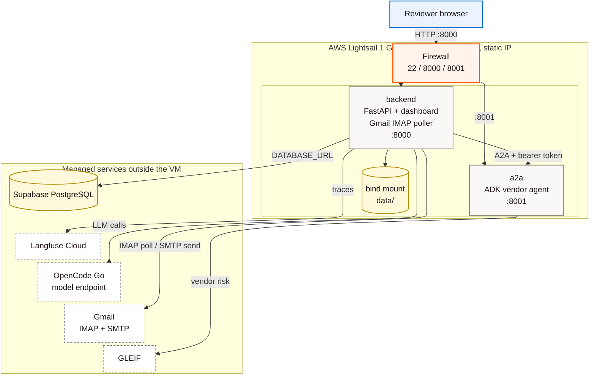

# AWS Lightsail / EC2 — cheapest all-in-one deployment

This runs the backend, dashboard, Gmail poller and A2A server on **one small
Ubuntu VM** with Docker Compose. Supabase and Langfuse stay external on their free
tiers, so there is no database or observability process on the VM.

## Deployment topology



Rendered: [SVG](../../docs/diagrams/aws-deployment.svg) · [PNG](../../docs/diagrams/aws-deployment.png) · [editable Mermaid source](../../docs/diagrams/aws-deployment.mmd).

The backend and A2A containers are the only application processes on the VM.
Supabase stores deals, events and snapshots; Langfuse stores traces; generated
DOCX/report files stay on the `data/` bind mount. Port `8000` serves the dashboard
and API, and the backend calls A2A on `8001`. Expose `8001` publicly only for
direct A2A debugging.

## Recommended size and cost

- **Lightsail 1 GB Ubuntu** — about **$5/month** (recommended minimum)
- Lightsail 512 MB — about $3.50/month, but CrewAI/ADK may be memory-tight
- EC2 t4g.small — use only if your AWS account still has free-tier/trial credit

A 1 GB Lightsail instance is the cheapest reliable option for this project.
Supabase Postgres, Langfuse and Cloudflare free tiers cost $0 for the demo.

## 1. Create external services

1. Create a Supabase project and copy its Postgres connection string.
2. Create a Langfuse Cloud project and copy public/secret keys.
3. Have an OpenCode Go API key and a Gmail App Password ready.

## 2. Create the VM

1. Create an Ubuntu 24.04 Lightsail instance (or EC2).
2. Attach a static IP.
3. Open firewall ports:
   - `22` — SSH
   - `8000` — backend/dashboard
   - `8001` — A2A
4. SSH into the instance.

For a demo, HTTP is acceptable but the Basic Auth password is not encrypted in
transit. For anything public, put a domain and TLS in front (Caddy/Cloudflare) or
use an SSH tunnel.

## 3. Install Docker and clone

```bash
sudo apt-get update
sudo apt-get install -y docker.io docker-compose-v2 git
sudo usermod -aG docker "$USER"
newgrp docker

sudo mkdir -p /opt/redliner
sudo chown "$USER":"$USER" /opt/redliner
git clone https://github.com/YOUR_USER/RedLiner.git /opt/redliner
cd /opt/redliner/deploy/aws
cp .env.example .env
nano .env
```

Set at minimum:

```dotenv
PUBLIC_HOST=<static-ip-or-dns>
DATABASE_URL=<supabase-postgres-url>
OPENCODE_API_KEY=<key>
SMTP_USER=<gmail>
SMTP_PASSWORD=<google-app-password>
SMTP_FROM=<gmail>
DEMO_PASSWORD=<demo-password>
A2A_SERVICE_TOKEN=<long-random-token>
REVIEWER_EMAIL=<your-email>
```

`PUBLIC_HOST` is used by Compose to build the A2A card URL and the backend's
`A2A_VENDOR_URL`.

## 4. Start

```bash
cd /opt/redliner/deploy/aws
docker compose up -d --build
docker compose ps
```

Check:

```bash
curl http://127.0.0.1:8000/api/health
curl http://127.0.0.1:8001/.well-known/agent-card.json \
  -H "Authorization: Bearer $A2A_SERVICE_TOKEN"
```

Open from your browser:

```text
http://<PUBLIC_HOST>:8000/
http://<PUBLIC_HOST>:8000/deals.html
```

The browser prompts for `DEMO_USER`/`DEMO_PASSWORD`.

## 5. Gmail inbound

The backend container runs the poller because Compose sets
`GMAIL_POLL_ENABLED=true`. Enable IMAP and create the `RedLiner` label/filter in
Gmail, as described in [`../../docs/HOSTED_DEMO.md`](../../docs/HOSTED_DEMO.md).

No Cloudflare, ngrok or local poller is needed.

## 6. A2A

The second container serves the ADK A2A agent on port `8001`. The backend's
CrewAI tool calls:

```text
http://<PUBLIC_HOST>:8001
```

The A2A service token must be present in the backend and A2A container. The agent
card URL is generated from `A2A_HOST`/`A2A_PORT`/`A2A_PROTOCOL` by Compose.

## Operations

```bash
cd /opt/redliner/deploy/aws
docker compose logs -f backend
docker compose restart backend
docker compose pull   # after pushing a new image/build
docker compose up -d --build
docker compose down
```

Retention:

```bash
docker compose exec backend .venv/bin/python scripts/purge_retention.py --days 90 --artifacts
```

## Limitations

- Single VM is a single point of failure; use one instance for a college demo.
- The demo uses HTTP unless you add TLS/Cloudflare.
- The `data/` directory is bind-mounted for generated files; Supabase stores deals
  and audit history.
- Gmail IMAP polling stops if the container stops.
- The A2A server uses in-memory task/session storage.
- No autoscaling, managed backups, WAF or per-user auth.
