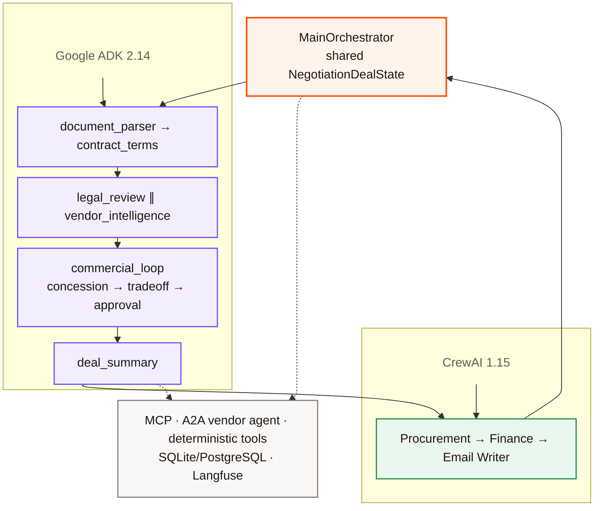

# Runtime migration milestone: CrewAI + Google ADK

This milestone replaces the LangGraph runtime with the two frameworks required by
the grading rubric: **CrewAI** and **Google ADK**.

## Runtime split

| Layer | Framework | Responsibility |
|---|---|---|
| `runtime/adk_runtime.py` | Google ADK 2.14 | Document parser, parallel legal/vendor review, trade-off/commercial checks, approval gate, review summary |
| `runtime/crew_runtime.py` | CrewAI 1.15 | Procurement negotiator, finance/compliance reviewer, vendor email writer |
| `agents/orchestrator.py` | Facade | Shares state between the ADK workflow and the CrewAI crew, preserves the FastAPI contract |
| `runtime/pipeline.py` | Python | Deterministic tools used by ADK nodes and the fallback path |

The runtime graph is:



Rendered: [SVG](diagrams/runtime.svg) · [PNG](diagrams/runtime.png) · [editable Mermaid source](diagrams/runtime.mmd).

CrewAI is disabled cleanly when `OPENCODE_API_KEY` is absent; the deterministic
email template and the ADK-only path remain available.

The CrewAI crew is sequential: procurement decision → finance review → email
draft. CrewAI uses OpenCode Go through its native OpenAI-compatible adapter, with
a per-request `x-opencode-session` header and Pydantic task outputs.

## Implemented

- ADK session state is used to pass parsed clauses, redline results, vendor
  profile, utility/guardrail analysis, approval status and review summary between
  agents.
- CrewAI receives the ADK output and produces a procurement plan, a finance
  review and an email draft.
- CrewAI is disabled cleanly when `OPENCODE_API_KEY` is absent; the existing
  template email is used.
- If an ADK node fails, `runtime/pipeline.deterministic_pipeline()` preserves the
  processing path and reports `*_ADK_FALLBACK`.
- The existing FastAPI endpoints, Gmail poller, SMTP/Cloudflare email paths and
  dashboard remain compatible.
- Webhook responses include `runtime_frameworks`, `crew_status`, `crew_error`,
  `crew_finance_review`, `adk_event_count`, `pipeline_error`, `mcp_tools_used`,
  `mcp_errors`, `iteration` and `convergence_reason`.
- **MCP:** `contract_tools.py`, `vendor_tools.py` and `finance_tools.py` are real
  stdio servers. ADK calls contract/vendor/finance over MCP; CrewAI exposes
  vendor, contract-metadata, utility, guardrail and trade-off tools.
- **Persistence:** SQLite `DealRepository` stores full state and event history in
  `data/redliner_deals.db`.
- **HITL:** `/api/deals/{id}/decision` supports approve, reject and manual edit,
  including an optional `edited_clauses` payload. Reject/edit starts a new
  iteration with reviewer feedback.
- **Convergence:** `/api/deals/{id}/counteroffer` applies vendor terms and runs a
  bounded next iteration; `max_iterations` produces `MAX_ITERATIONS_REACHED`.
- **ADK LoopAgent:** an explicit `commercial_loop` runs concession/tradeoff rounds
  inside the ADK workflow.
- **Email threading:** sent messages carry `Message-ID`/`X-RedLiner-Deal`; inbound
  replies are matched to the deal and routed to counteroffer handling.
- **Extraction:** price, Net terms and liability caps are extracted; low
  confidence routes to human review.
- **A2A:** an ADK Vendor Intelligence agent is exposed over A2A and called by a
  CrewAI tool.
- **Workbench:** `/deals.html` supports deal summaries, clauses/redlines, email
  dispatch, DOCX/report downloads, approve/reject/manual-edit (including edited
  clause JSON), counteroffers, snapshots/events, trace links and effective demo
  settings. Email/webhook reviewer notifications are optional.
- **Final report:** `/api/deals/{id}/report?format=json|markdown` includes
  contract terms, redlines, finance, approvals, history, MCP/A2A/runtime metadata
  and usage. Contract price/Net/liability/term terms are extracted from clauses.
- **Live OSINT:** GLEIF registry lookup with normalized/fuzzy legal-name scoring,
  country/legal-form disambiguation, ambiguity candidates, optional
  Tavily/Serper search, DuckDuckGo fallback and provenance fields.
- **LLM guardrails:** prompt-injection, secret leakage, abuse, PII warnings and
  output checks around OpenCode/CrewAI calls; blocked output falls back safely.
- **Langfuse:** optional cloud traces for deal/ADK/CrewAI/LLM/MCP/A2A/approval
  spans, with trace URLs stored in state and report; no-op without keys.
- **Evaluation:** reproducible 24-contract labelled evaluation, quality and
  latency report, live LLM usage/cost option, published in `docs/EVALUATION.md`.
- **Storage:** PostgreSQL/Supabase is selectable via `DATABASE_URL`; retention is
  controlled by `RETENTION_DAYS` and `scripts/purge_retention.py`.
- LangGraph was removed from `pyproject.toml` and the application code.

## Configure OpenCode Go

Create a local `.env` from `.env.example` and set:

```dotenv
OPENCODE_API_KEY=your-opencode-console-key
OPENCODE_MODEL=glm-5.3-flash
MCP_ENABLED=true
# Optional: override the default SQLite path
# REDLINER_DB_PATH=data/redliner_deals.db
```

Then:

```bash
uv sync --python 3.12
PYTHONPATH=. uv run python -m uvicorn server.app:app --host 127.0.0.1 --port 8000 --reload
```

## Verify the frameworks

```bash
# 86 tests: core, API, framework, MCP including finance tools, A2A status, GLEIF matching, OSINT, guardrails, Langfuse tracing, LLM streaming, email threading, sample fixtures including Common Paper/ACC-Cooley-inspired examples, sample mailer, email signatures, utility pricing, storage, demo auth, reports, failure paths and HITL
PYTHONPATH=. uv run pytest -q

# Confirm the dependency graph is CrewAI + ADK, not LangGraph
grep -R "langgraph" pyproject.toml agents runtime || true
```

A live CrewAI run requires a valid OpenCode key and available Go model. A live
ADK-only run works without a key because the ADK nodes are deterministic workflow
agents; the CrewAI layer is skipped.

## Email and deployment

- Direct SMTP is the default outbound path (`EMAIL_PROVIDER=smtp`).
- Cloudflare Email Routing + Worker remains the optional inbound edge; the
  Gmail IMAP poller is the no-domain alternative.
- See [`DEPLOYMENT.md`](DEPLOYMENT.md) for Render/Cloudflare steps.

## Known gaps

- A2A has a shared service token but uses in-memory task/session stores; add
  OAuth/mTLS and a persistent task store before exposing it publicly.
- The workbench/API use one shared Basic Auth login; there are no per-user roles,
  per-deal assignments, RLS or Supabase Auth.
- Notification delivery is best-effort; there is no durable outbox/retry worker.
- Counteroffer extraction is deterministic; LLM extraction is not wired in.
- The ADK `LoopAgent` covers internal concession rounds; external email replies
  still trigger a new facade run.
- PostgreSQL/Supabase works through `DATABASE_URL`, but file storage, RLS,
  backups and a production retention job are deployment tasks.
- CrewAI runs sequentially; the ADK workflow supplies the supervisor/parallel
  patterns.
- Langfuse traces are optional; richer dashboards/evals, controlled cost
  benchmarking and production deployment remain future work.
- The `a.py`/`b.py` diagrams in the parent workspace are still legacy LangGraph
  diagrams and must be redrawn with CrewAI/ADK labels.
