# RedLiner diagrams

Editable Mermaid sources and rendered outputs. The Mermaid blocks in the docs
remain the primary editable source; these files are for GitHub previews, slides
and reports.

The layouts are compact and page-oriented for documents. Optional edge/TLS nodes
(Cloudflare/Caddy, Email Routing) and optional search providers (Tavily/Serper)
are omitted from the diagrams.

| Diagram | Mermaid source | SVG | PNG |
|---|---|---|---|
| System architecture | [architecture.mmd](architecture.mmd) | [SVG](architecture.svg) | [PNG](architecture.png) |
| Runtime split (ADK + CrewAI) | [runtime.mmd](runtime.mmd) | [SVG](runtime.svg) | [PNG](runtime.png) |
| Agent topology | [agent-topology.mmd](agent-topology.mmd) | [SVG](agent-topology.svg) | [PNG](agent-topology.png) |
| MCP tool architecture | [mcp-architecture.mmd](mcp-architecture.mmd) | [SVG](mcp-architecture.svg) | [PNG](mcp-architecture.png) |
| AWS Compose deployment | [aws-deployment.mmd](aws-deployment.mmd) | [SVG](aws-deployment.svg) | [PNG](aws-deployment.png) |

## System architecture



## Runtime split


## Agent topology



## MCP tool architecture



## AWS deployment topology


## Regenerate

From the repository root:

```bash
./scripts/render_diagrams.sh
```

The script uses `npx @mermaid-js/mermaid-cli` and a local Chrome/Chromium. Set
`PUPPETEER_EXECUTABLE_PATH` if the browser is not found automatically.
